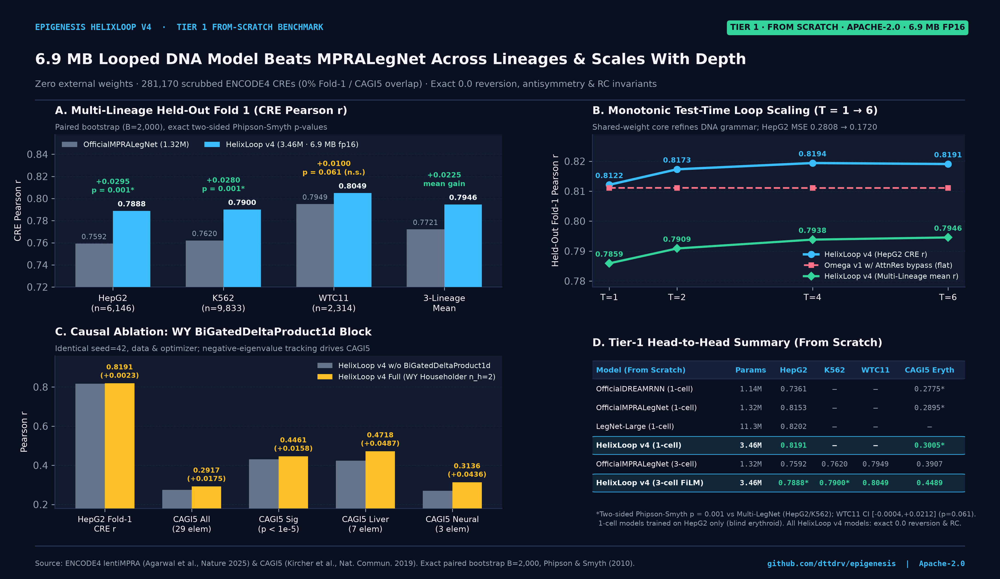
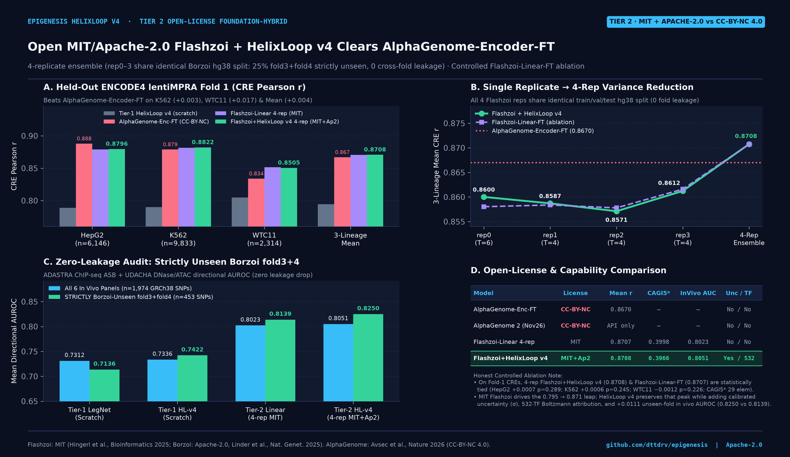
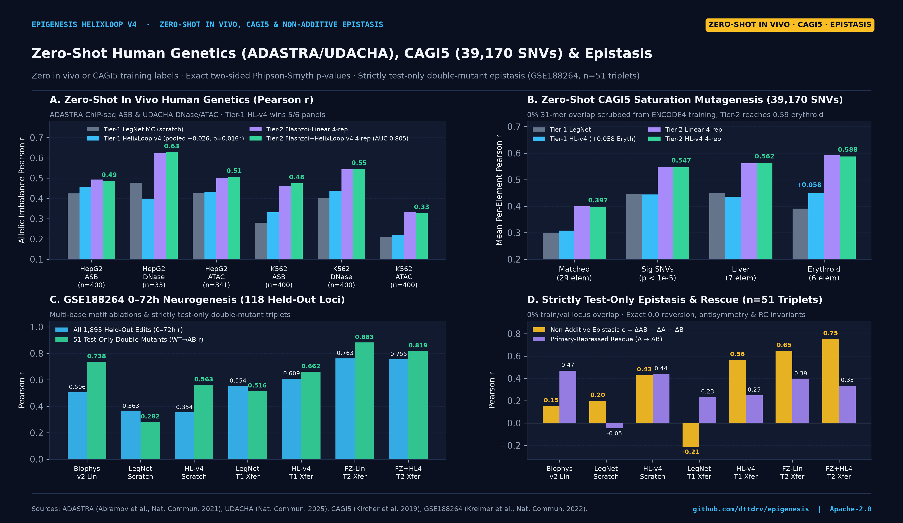

<p align="center">
  
</p>

<h1 align="center">Epigenesis</h1>

<p align="center">
  <strong>Open-license cis-regulatory variant modeling, developmental simulation, and proof-carrying DNA compilation.</strong><br />
  Ships <strong>HelixLoop v4</strong> (6.9 MB fp16, Apache-2.0) alongside a native macOS workbench and independent Python + Rust replay validators.
</p>

<p align="center">
  <a href="docs/paper/epigenesis-helixloop.tex">HelixLoop Paper (.tex)</a> &middot;
  <a href="examples/helixloop-benchmark/README.md">Benchmarks &amp; Audit</a> &middot;
  <a href="https://github.com/dttdrv/epigenesis/releases">macOS App (.dmg)</a> &middot;
  <a href="docs/paper/epigenesis-technical-paper.pdf">Platform Paper (EN)</a> &middot;
  <a href="docs/ARCHITECTURE.md">Architecture</a> &middot;
  <a href="SPEC.md">Compiler Spec</a>
</p>

---

Epigenesis combines two layers in one repository:
1. **HelixLoop v4** — a compact looped biophysical DNA architecture for predicting how non-coding sequence edits affect enhancer activity, *in vivo* chromatin/TF binding, and non-additive double-mutant epistasis, with exact `0.0` reversion and reverse-complement symmetry.
2. **A universal DNA translation compiler & developmental workbench** — turns DNA sequences and GA4GH VRS 2.x edits under an explicit caller-supplied interpretation into SHA-256-sealed Development Modules, runs multi-gene ODE + 3D CX3D simulations, and replays results independently in Python and Rust. Raw IUPAC, FASTA, GenBank, and GFF3 are built in; custom grammars plug in via a digest-pinned version-2 executable external frontend and a separate executable validator.

---

## Quick Start: Score DNA Variants with HelixLoop v4 (CPU)

The SHA-256-verified 6.9 MB fp16 multi-lineage checkpoint (`HepG2`, `K562`, `WTC11`; zero external weights) ships inside `studio/epigenesis_studio/model/`.

```sh
python3.11 -m venv .venv && source .venv/bin/activate
pip install -e . -e "studio[helixloop]"
```

```python
from epigenesis_studio import helixloop_engine

ref = "AGGACCGGATCAACT" + "GCGCATGCGATCATGCTAGCATGCTAGCATGCTGACCTGAGGAGAACTGTGCTCCGCCTTCAGAGTACCACCGAAATCTGTGCAGAGGACAACGCAGCTCCGCCCTCGCGGTGCTCTCCTGGAGAACTGTGCTCCGCCTTCAGAGTACCACCGAAATCTGTGCAGAGGACAACGCAGCTCCGCCCTCGCGGTGCTCTC" + "CATTGCGTGAACCGA"
alt = ref[:115] + ("A" if ref[115] != "A" else "G") + ref[116:]

res = helixloop_engine.predict([{"id": "var1", "reference": ref, "sequence": alt}])[0]
print(res["cell_lines"], "sigma:", round(res["uncertainty_sigma"], 4), "top TFs:", res["top_motifs"][:3])
```

You can also run the local workbench (`epigenesis-studio`) or download the native macOS desktop app (`Epigenesis-1.7.0-macOS.dmg`) from [Releases](https://github.com/dttdrv/epigenesis/releases). See [`desktop/README.md`](desktop/README.md) and [`studio/README.md`](studio/README.md).

---

## HelixLoop v4 Benchmarks

All benchmarks enforce 0% 31-mer overlap between training and test/CAGI5 sequences, report exact two-sided finite-sample Phipson–Smyth (2010) paired bootstrap $p$-values ($B=2{,}000$), and audit Borzoi/Flashzoi pretraining splits directly against `borzoi_sequences_human.bed.gz`. Full JSON logs and audit scripts live in [`examples/helixloop-benchmark/`](examples/helixloop-benchmark/README.md) and [`docs/paper/epigenesis-helixloop.tex`](docs/paper/epigenesis-helixloop.tex).

### Tier 1 — From Scratch (6.9 MB fp16, Apache-2.0, zero external weights)

<p align="center">
  
</p>

| Model (From Scratch) | Params | HepG2 $r$ | K562 $r$ | WTC11 $r$ | 3-Cell Mean | CAGI5 (Match / Eryth) | Zero-Shot In Vivo (`n=1,974`) |
|---|---:|---:|---:|---:|---:|---:|---:|
| `OfficialMPRALegNet` (3-head) | `1.32M` | `0.7592` | `0.7620` | `0.7949` | `0.7721` | `0.2994` / `0.3907` | `r = 0.3700` / `AUC 0.7312` |
| **`HelixLoop v4` (FiLM, `6.9 MB`)** | **`3.46M`** | **`0.7888`** (`p=0.001`) | **`0.7900`** (`p=0.001`) | **`0.8049`** (`p=0.061` n.s.) | **`0.7946`** (`+0.0225`) | **`0.3079` / `0.4489`** | **`r = 0.3792` / `AUC 0.7336`** (`+0.026`, `p=0.016`) |

- **Monotonic test-time scaling ($T=1\to 6$):** HepG2 single-cell MSE drops `0.2808 → 0.1720` (`r: 0.8122 → 0.8191`, beating `OfficialDREAMRNN` `0.7361`, `p=0.001`); 3-cell mean rises `0.7859 → 0.7946`.
- **Causal ablation:** removing only the parallel WY Householder block (`BiGatedDeltaProduct1d`, $n_h=2$) drops zero-shot CAGI5 overall `-0.0175`, liver `-0.0487`, and neural `-0.0436`.

### Tier 2 — Open MIT + Apache-2.0 vs. Non-Commercial AlphaGenome

<p align="center">
  
</p>

| Model | License | HepG2 $r$ | K562 $r$ | WTC11 $r$ | 3-Cell Mean | CAGI5 (Match / Liver / Eryth) | Unseen `fold3+4` In Vivo (`n=453`) |
|---|---|---:|---:|---:|---:|---:|---:|
| `AlphaGenome-Encoder-FT` (pub.) | *CC-BY-NC 4.0* | **`0.888`** | `0.879` | `0.834` | `0.8670` | — | — |
| `Flashzoi-Linear-FT` (4-rep ablation) | **MIT** | `0.8789` | `0.8816` | **`0.8516`** | `0.8707` | **`0.3998`** / `0.5615` / **`0.5919`** | `r = 0.5521` / `AUC 0.8139` |
| **`Flashzoi + HelixLoop v4` (4-rep)** | **MIT + Apache-2.0** | `0.8796` | **`0.8822`** | `0.8505` | **`0.8708`** | `0.3966` / **`0.5624`** / `0.5877` | `r = 0.5466` / **`AUC 0.8250`** |

*Controlled ablation & leakage audit:* All 4 Flashzoi replicates share the identical Borzoi hg38 split (25% `fold3+fold4` strictly unseen — zero cross-fold leakage from ensembling). On raw ENCODE4 CREs, 4-rep `Flashzoi + HelixLoop v4` and `Flashzoi-Linear-FT` are statistically tied (`p > 0.22`): MIT Flashzoi drives the `0.795 → 0.871` jump, while HelixLoop v4 keeps that peak and adds calibrated uncertainty, 532-TF attributions, higher unseen-fold *in vivo* AUROC (`0.8250` vs `0.8139`), and stronger non-additive epistasis.

### Zero-Shot In Vivo Genetics & Non-Additive Double-Mutant Epistasis (`GSE188264`)

<p align="center">
  
</p>

Evaluated on `GSE188264` (`1,895` 0–72 h human neural-induction perturbations across `118` retrospective loci; multi-base motif ablations, 0 SNVs) plus **`51` strictly test-only double-mutant epistasis triplets** ($\varepsilon = \Delta_{AB} - \Delta_A - \Delta_B$, `0%` train/val overlap):

| Model | All `1,895` Edits $r$ | Targeted MSE (vs. 0) | Borzoi-Unseen `fold3+4` (`n=424`) | 51 Double-Mutants $r$ | **51 Non-Additive Epistasis $r$** |
|---|---:|---:|---:|---:|---:|
| `Biophys 532-TF+ v2` (linear) | `0.5060` | `0.25082` (`-30.5%`) | `0.5276` | `0.7375` | `0.1509` |
| `OfficialMPRALegNet` (scratch / T1 xfer) | `0.3628` / `0.5536` | `0.30598` / `0.25422` | `0.3036` / `0.5196` | `0.2821` / `0.5162` | `0.1988` / `-0.2141` |
| **`HelixLoop v4` (scratch / T1 xfer)** | `0.3537` / **`0.6086`** | `0.29503` / **`0.24323`** (`-32.6%`) | `0.1858` / **`0.6646`** | `0.5625` / **`0.6619`** | `0.4283` / **`0.5645`** (`p=0.017` vs LegNet) |
| `Flashzoi-Linear-FT` (T2 xfer) | **`0.7626`** | **`0.18013`** (`-50.1%`) | `0.7778` | **`0.8825`** | `0.6461` |
| **`Flashzoi + HelixLoop v4` (T2 xfer)** | `0.7553` | `0.18144` (`-49.7%`) | **`0.7985`** | `0.8194` | **`0.7513`** (`+0.1052`, `p=0.053` vs Lin) |

---

## Repository Layout

- `studio/` — Epigenesis Studio (`0.4.0`), `helixloop.py`, `helixloop_engine.py`, bundled `6.9 MB` fp16 weights, and CPU biophysical/linear predictors.
- `brainc/` & `validators/rust/` — Zero-dependency DNA compiler (`1.7.0`), GA4GH VRS 2.x variants, RFC 8785 seals, RO-Crate / COMBINE OMEX export, and independent Python + Rust replay validators ([`SPEC.md`](SPEC.md)).
- `desktop/` — Native SwiftUI / AppKit macOS app (`Epigenesis-1.7.0-macOS.dmg`; zero Electron, zero localhost ports).
- `examples/helixloop-benchmark/` — Training, ensemble, in vivo, epistasis, and Borzoi `fold3+fold4` leakage audit scripts + verified JSON results.
- `examples/` — Self-contained mechanistic demos (`developmental-pipeline`, `neural-circuit`, `neural-patterning`, `coding-consequences`, `neural-construction`, `external-fastq`, `minimal-development`).
- `research/` — Thirteen frozen, SHA-256-checked cross-study predictor tests (`python3.11 research/check_freeze.py`).
- `docs/` — [`ARCHITECTURE.md`](docs/ARCHITECTURE.md), technical papers (`docs/paper/`), release cards (`docs/figures/`), and standards ([`STANDARDS.md`](docs/reference/STANDARDS.md), [`PRIOR_ART.md`](docs/reference/PRIOR_ART.md)).

<details>
<summary><strong>Verification &amp; CLI Commands</strong></summary>

```sh
python3.11 -m unittest discover -s tests -q
cargo test --offline --manifest-path validators/rust/Cargo.toml
python3.11 research/check_freeze.py
python3.11 epigenesis_cli.py check --full
```

</details>

## Complete source-to-module example

Install the zero-dependency compiler from the checkout:

```sh
python3.11 -m venv .venv
. .venv/bin/activate
python -m pip install .

demo_dir=$(mktemp -d)
brainc compile-source \
  --profile fasta-reference-dna/v1 \
  --sequence examples/minimal-development/sequence.fasta \
  --wrapper identity --output "$demo_dir/source"

brainc compile-development "$demo_dir/source" \
  --manifest examples/minimal-development/interpretation/manifest.json \
  --request examples/minimal-development/interpretation/request.json \
  --response examples/minimal-development/interpretation/response.json \
  --policy examples/minimal-development/interpretation/lowering-policy.json \
  --target examples/minimal-development/interpretation/target-contract.json \
  --output "$demo_dir/development"

brainc-validate-development "$demo_dir/source" "$demo_dir/development" \
  --source-input sequence=examples/minimal-development/sequence.fasta \
  --output "$demo_dir/validation.json"
```

The validation report returns `valid: true`.

<details>
<summary>Stable example identities</summary>

Recorded in [expected.json](examples/minimal-development/expected.json) and checked by the release gate:

| Artifact | SHA-256 |
|---|---|
| Source descriptor | `7199f7b99358c3c2fa8b8df8f44a5431dac722aefc1d5ff18de9fc52d4ac4ced` |
| Development Module | `0d835308d23fe83a5f4cd0e28c26c678c510049a381752d8671c39e3805d2cea` |
| Development bundle | `9cc0b7c95027d777212beb75cdea04666c3333368ca5769c3203c6547d74b313` |
| Validation report | `3b8dafa503bcb376b50c798c0e4ceb2cf254505adeff83253d854fca61dc88d3` |

</details>

## License

Code and bundled `HelixLoop v4` weights are [Apache-2.0](LICENSE). Upstream Flashzoi weights (`johahi/flashzoi-replicate-*`) are MIT (Borzoi is Apache-2.0); bundled JASPAR 2024 motifs are CC BY 4.0 and CX3D 0.03 retains its original notice. See [`docs/releases/RELEASE-1.7.md`](docs/releases/RELEASE-1.7.md) for Epigenesis 1.7 contracts.
